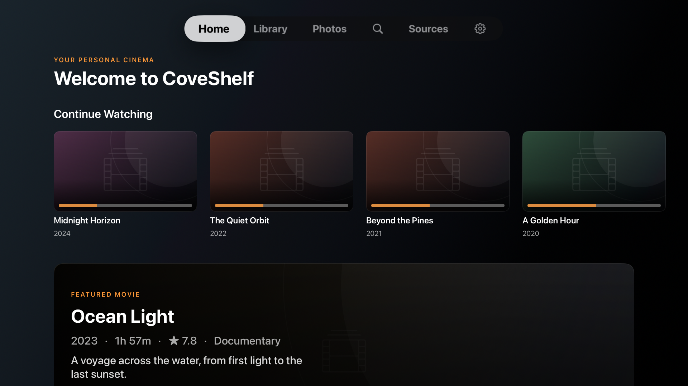
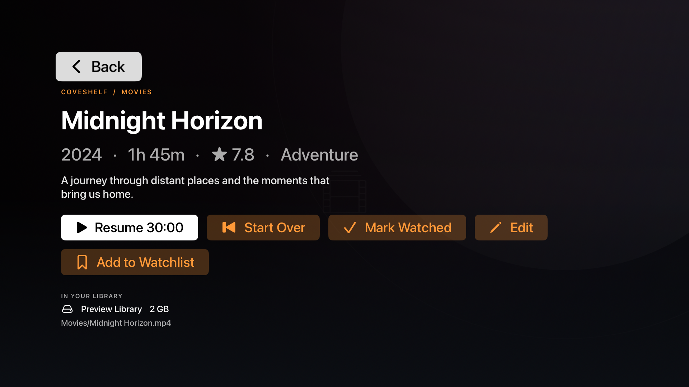

# CoveShelf

Add one parent NAS folder to build your Movies, Documentaries, TV Shows, Music, and Photos library. See the [media setup and naming guide](docs/MEDIA-GUIDE.md) for folder examples, photo albums, free personal TMDB setup, and playback help. CoveShelf was previously named Cine-Media; the existing CineVault project and app identifiers are retained so updates keep your saved library and credentials.

A personal media library for **Apple TV and Android TV** that plays movies,
shows and music and displays photo albums directly from a NAS over SMB.
Built with SwiftUI on tvOS and Compose for TV on Android.

## Android TV

The Android TV app includes direct SMB playback, a personal Watchlist,
library management, saved source/genre/decade filters, search, photo albums, and TMDB metadata. See the [Android guide](docs/ANDROID.md)
for build and installation instructions, release signing, and a first NAS playback
test. Android billing and Google Play distribution remain pending. Real Android TV
device and NAS validation has not yet been completed.

## Apple TV features

- Add one or more NAS sources (SMB2/3: Synology, QNAP, TrueNAS, Windows shares…). Passwords live in the Keychain.
- Recursive scan for media files; skips samples, trailers, extras and NAS metadata folders (`@eaDir`, `#recycle`, …). Playback checks the current file size on the NAS, even if a file changed since its last scan.
- NAS credential, scan, and TMDB lookup errors are shown in the app rather than silently reported as successful.
- Smart filename parsing (`The.Matrix.1999.1080p.BluRay.x264-GRP.mkv` → *The Matrix (1999)*), folder fallback (`Heat (1995)/movie.mkv`) and `{tmdb-123}` tags.
- Posters, backdrops, overview, genres, runtime and rating from TMDB (your own free API key).
- Cinematic Apple TV browsing with backdrop artwork, landscape Continue Watching cards, focus-aware posters, a movie detail screen, and a dark, uncluttered interface.
- Home (Continue Watching / Recently Added / Unwatched), full library grid with sort + filter + genre, and search.
- Personal Watchlist with a Home shelf and library filter. Select multiple genres, sources, or decades and save the combination. [Browse with filters](docs/MEDIA-GUIDE.md#browse-with-filters)
- Photo albums grouped by NAS source and folder, with thumbnails and a full-screen viewer. [Browse photo albums](docs/MEDIA-GUIDE.md#browse-photo-albums)
- Streaming playback with AVPlayer via a custom resource loader that serves byte ranges straight from SMB — instant start and seeking, nothing is downloaded first.
- Resume position, watched state (automatic after 92%), progress bars. Replaying a watched movie makes it resumable again.
- Manage entries: rename, fix match (search TMDB and pick), hide, reset progress, reset to file name.
- Library persisted with SwiftData.

### Format support

For video on Apple TV, CoveShelf checks MP4, M4V, and MOV files with the native player before playback. The codecs inside the file must also work on the device. The [Media Guide](docs/MEDIA-GUIDE.md#check-the-scan-and-playback) lists the supported video and audio formats on each platform and explains how the scanner distinguishes MPEG-TS recordings from TypeScript files. Photos are grouped into albums by NAS source and folder; JPEG, PNG, WebP, HEIC, and HEIF viewing depends on the device's image decoder.

## Screenshots

Apple TV simulator previews with a sample library and placeholder artwork:

**Home**



**Movie details**



## Project layout

| Path | What |
|---|---|
| `project.yml` | XcodeGen spec — the Xcode project is generated, not committed |
| `project.commercial.yml` | Optional XcodeGen overlay for a licensed commercial build |
| `CineVault/` | tvOS app (SwiftUI, SwiftData, AVKit) |
| `Packages/CineVaultCore/` | Pure Swift logic (filename parser, file filter, TMDB models, title matcher) + unit tests |
| `scripts/generate_app_icons.py` | Generates the layered tvOS icons / top-shelf images (stdlib only) |
| `.github/workflows/ci.yml` | Core tests + unsigned tvOS build on every push/PR |
| `.github/workflows/nas-integration.yml` | Simulator tests against a temporary local SMB fixture |
| `.github/workflows/ui-preview.yml` | On-demand Apple TV simulator screenshots with a sample library |
| `.github/workflows/commercial.yml` | Protected, manually requested commercial build and optional TestFlight upload |
| `fastlane/Fastfile` | Signing and TestFlight helper |

Dependencies: [AMSMB2](https://github.com/amosavian/AMSMB2) (SMB client). It wraps libsmb2 (LGPL‑2.1); its SwiftPM product is a **dynamic** framework, so it ships as a separate, replaceable `AMSMB2.framework` inside the app, as LGPL requires.

### Public and official builds

The community app builds independently, without a private dependency or repository token.
An optional private `CineVaultCommercial` Swift package adds local playback tracking and
StoreKit purchases to a licensed commercial build. Developer access to that package is
arranged manually with the maintainer after payment; this repository does not process
developer-license payments or automatically grant access. Contact the maintainer
privately through their [GitHub profile](https://github.com/dinesh-devkota) to arrange access.

The official commercial app allows three trial plays: the first two are unrestricted,
and the third stops at 90% and offers a purchase. Resuming an unfinished movie continues
its existing play; starting over consumes another play. The intended Apple purchase
options are approximately US$1 per month or US$12 for a lifetime unlock. Apple displays
the actual localized prices configured in App Store Connect.

The official app's [privacy policy](docs/PRIVACY.md) is publicly readable so users and
App Review can access it without permission to the private repository.

`project.commercial.yml` adds the package and defines `CINEVAULT_COMMERCIAL` for the app.
This flag requires the module at compile time, so a commercial build cannot silently
fall back to the community variant. The module's source and credentials must never be
committed to this repository. A private module protects its source, not the compiled code
distributed inside the app, and does not prevent independent community forks.

## Building without a Mac

Everything builds on GitHub's macOS runners:

1. Push to `main` → **CI** runs `swift test` for the core package and an unsigned tvOS build.
2. Licensed developers can manually run **Commercial build** in their public repository.
   It fetches an explicitly pinned private package, tests it, builds the tvOS app, and can
   optionally sign and upload it to TestFlight. No workflow runs in the private repository.
   Simulator tests use temporary ad-hoc signing for Keychain access; they do not need Apple
   signing credentials.

For a visual check without a Mac, run **UI preview** from the Actions tab and download the
`cinevault-ui-preview` artifact. It captures Home, movie details, and the Genre picker using an
in-memory sample library with placeholder artwork; it never connects to a NAS or changes
your real collection. The workflow checks for screen-specific text before accepting each
capture, and uploads diagnostic screenshots if a preview fails.

### Test on your own Apple TV

**From Windows**, use the [Apple distribution setup](#one-time-apple-setup-all-doable-from-windows) and [TestFlight installation steps](#installing-on-apple-tv-testflight). GitHub's macOS runner builds and signs the app using your developer team's credentials. TestFlight requires an Apple TV running tvOS 18 or later. [TestFlight requirements](https://testflight.apple.com/)

You can run the community app on your Apple TV using a Mac with Xcode and a free Apple Account. The app requires tvOS 17 or later. [Apple’s personal-device testing guide](https://developer.apple.com/help/account/basics/about-your-developer-account/)

1. On the Mac, open a terminal in this repository and generate the Xcode project.

   ```sh
   brew install xcodegen
   python3 scripts/generate_app_icons.py
   xcodegen generate
   open CineVault.xcodeproj
   ```

2. Sign in to your Apple Account in Xcode. In the **CineVault** app target, open **Signing & Capabilities**, enable automatic signing and choose your **Personal Team**. If Xcode asks for a unique bundle identifier, set one for your local test build.
3. Pair the Apple TV with the Mac in Xcode, select the **CineVault** scheme and your Apple TV as the destination, then click **Run**. [Apple’s device pairing guide](https://developer.apple.com/documentation/xcode/managing-your-simulated-and-physical-devices-in-device-hub)

Once CoveShelf is installed, open **Sources → Add NAS** and select a folder containing a known-good H.264/AAC MP4. After the scan, open the title, play it, seek forward, and return to its detail screen to check the saved resume point. See the [Media Guide](docs/MEDIA-GUIDE.md) for folder exclusions and photo albums.

### Configure a commercial build

1. Obtain access to `dinesh-devkota/CineVaultCommercial` and a trusted, full 40-character
   commit SHA from the maintainer. Create a fine-grained GitHub token with **Contents: read**
   access to that private repository. Do not put the token in a URL or source file.
2. In your **public** app repository, create an Actions environment named `commercial`.
   Add at least one **required reviewer**, restrict deployment branches to `main`, and
   disable administrator bypass. Allow self-review if the repository owner is the only
   reviewer. Keep the environment protected and review both revisions before approving a run.
3. Add `COMMERCIAL_REPO_TOKEN` as an **environment secret** in `commercial`. For TestFlight,
   add the Apple secrets listed below to the same environment. Do not use repository-wide
   secrets for these credentials.
4. Open Actions → **Commercial build** → **Run workflow**, select `main`, enter the private
   commit SHA, and optionally enable TestFlight upload. Approve the protected environment
   when prompted. The workflow accepts requests and reruns only from the personal repository
   owner; organization-owned forks need an appropriately reviewed authorization policy.

Public Actions logs are visible to everyone. Commercial compiler and test output is captured
instead of printed, and no app or raw diagnostic artifact is uploaded. You can optionally
configure encrypted failure diagnostics as described below. Keep the public branch, action
pins, private revision, environment reviewers, and repository access trusted.

On a Mac, an authorized developer can instead clone the private package into the ignored
`commercial` directory, check out the trusted SHA, and run:

```bash
swift test --package-path commercial
python3 scripts/generate_app_icons.py
xcodegen generate --spec project.commercial.yml
xcodebuild -project CineVault.xcodeproj -scheme CineVault -destination 'generic/platform=tvOS' -configuration Release CODE_SIGNING_ALLOWED=NO build
```

#### Optional encrypted diagnostics

Without a diagnostic certificate, a failed commercial step reports its stage and exit code
but does not publish private output. To download encrypted diagnostics, create a certificate
and private key **outside the repository**, and keep the key private:

```bash
openssl req -x509 -newkey rsa:3072 -sha256 -nodes -days 3650 \
  -keyout commercial-diagnostics.key -out commercial-diagnostics.crt \
  -subj "/CN=CoveShelf build diagnostics"
```

Set the `commercial` environment variable `COMMERCIAL_DIAGNOSTICS_CERT_BASE64` to the base64
of the certificate, not the private key. On Windows, copy it with
`[Convert]::ToBase64String([IO.File]::ReadAllBytes("commercial-diagnostics.crt")) | Set-Clipboard`.
After a failure, download `commercial-diagnostics-encrypted` and decrypt its `.p7m` file
outside the repository:

```bash
openssl cms -decrypt -binary -inform DER -in cinevault-commercial-diagnostics.p7m \
  -recip commercial-diagnostics.crt -inkey commercial-diagnostics.key -out commercial-build.log
```

Anyone with the private key can read the diagnostic log; it may contain private source or
signing details. Do not publish the decrypted log.

## One-time Apple setup (all doable from Windows)

TestFlight and App Store distribution require Apple Developer Program membership. [Apple’s membership overview](https://developer.apple.com/help/account/membership/programs-overview/)

1. **Bundle ID** — developer.apple.com → Certificates, IDs & Profiles → Identifiers → **+** → App IDs → App, bundle ID `com.dineshdevkota.cinevault` (or your own; then set the `commercial` environment variable `APP_BUNDLE_ID`).
2. **App record** — appstoreconnect.apple.com → Apps → **+** → New App, platform **tvOS**, same bundle ID.
3. **In-app purchases** — create an auto-renewable monthly subscription in a subscription
   group and a non-consumable lifetime product. By default their IDs are your bundle ID
   followed by `.monthly` and `.lifetime`; for the default bundle ID these are
   `com.dineshdevkota.cinevault.monthly` and `com.dineshdevkota.cinevault.lifetime`.
   If you use different IDs, set environment variables `CINEVAULT_MONTHLY_PRODUCT_ID` and
   `CINEVAULT_LIFETIME_PRODUCT_ID`. Set the intended US price tiers to US$1/month and
   US$12 lifetime, or the nearest available tiers, and submit the products with the first
   app version. Test purchases and restoration with a sandbox Apple Account.
4. **App Store Connect API key** — App Store Connect → Users and Access → Integrations → App Store Connect API → generate a key with **App Manager** role. Note the *Key ID* and *Issuer ID*, download the `.p8`.
5. **Distribution certificate** — run these OpenSSL commands (e.g. in Git Bash) from a private folder **outside the repository**. Keep the `.key`, `.p12`, `.p8`, and password private:
   ```bash
   openssl genrsa -out dist.key 2048
   openssl req -new -key dist.key -out dist.csr -subj "/emailAddress=you@example.com/CN=CoveShelf/C=US"
   ```
   developer.apple.com → Certificates → **+** → *Apple Distribution* → upload `dist.csr`, download `distribution.cer`, then:
   ```bash
   openssl x509 -inform DER -in distribution.cer -out dist.pem
   openssl pkcs12 -export -legacy -inkey dist.key -in dist.pem -out dist.p12 -passout pass:CHOOSE_A_PASSWORD
   ```
   (Drop `-legacy` if your OpenSSL is older than 3.0.)
6. **Commercial environment secrets** in the public build repository (GitHub → Settings →
   Environments → `commercial`). Do not commit these or add them as repository-wide secrets:

   | Secret | Value |
   |---|---|
   | `ASC_KEY_ID` | API key ID |
   | `ASC_ISSUER_ID` | API issuer ID |
   | `ASC_KEY_P8_BASE64` | base64 of the `.p8` file |
   | `APPLE_TEAM_ID` | 10-char Team ID (Membership page) |
   | `DIST_CERT_P12_BASE64` | base64 of `dist.p12` |
   | `DIST_CERT_PASSWORD` | the p12 password |

   Base64 on Windows PowerShell: `[Convert]::ToBase64String([IO.File]::ReadAllBytes("dist.p12")) | Set-Clipboard`.

The commercial workflow handles the provisioning profile and build number. For local
Fastlane builds, the same bundle and product IDs can be provided as environment variables.

## Installing on Apple TV (TestFlight)

1. After **Commercial build** succeeds with TestFlight upload enabled, wait for processing in App Store Connect (≈10–30 min).
2. App Store Connect → your app → **TestFlight** → add yourself as an internal tester.
3. Install **TestFlight** from the App Store on your Apple TV. Open your invitation email on Windows and choose **View in TestFlight**. Enter the displayed code under **Redeem** in TestFlight on the TV, then install **CoveShelf**. [Apple’s tvOS installation instructions](https://testflight.apple.com/)

## Publishing to the App Store

1. First install the TestFlight build and verify connecting to your NAS, browsing, and playing a movie on a real Apple TV.
2. In App Store Connect, open your app's **tvOS** version and complete its description, screenshots, age rating, pricing, availability, support and privacy information. The simulator screenshots in `docs/screenshots/` use a sample library.
3. Add App Review notes explaining that the app needs an SMB share, and provide a safe way for reviewers to exercise the app. Do not put private NAS credentials in the repository.
4. Select the processed build in the **Build** section, choose **Add for Review**, and then **Submit for Review**. After Apple approves it, release it according to the availability option you selected.

## Using the app

1. **Settings** → paste your TMDB key (themoviedb.org → Settings → API; the v3 key or the v4 "read access token" both work).
2. **Sources** → *Add NAS Source*: host/IP, username/password (empty = guest), share (use *List Shares*), and the folder inside the share (e.g. `Movies`). *Test Connection*, then *Save & Scan*.
3. Browse **Home** / **Movies**, press a poster to see details and play. Long scans run in the background; rescans happen on launch.
4. Wrong poster? Open the movie → **Edit** → *Fix Match* and pick the right result, or rename it. Use *Hidden from library* to hide entries (see them under Movies → Show → Hidden).

Tip: naming folders `Title (Year)/Title (Year).mp4` gives the best matches; add `{tmdb-12345}` to force one.

## Tests

```bash
cd Packages/CineVaultCore && swift test
```

The public CI also runs `python3 -m unittest discover -s scripts/tests -p 'test_commercial_*.py'`
to check commercial build helpers and keep private command output out of public logs.

See [Testing](docs/TESTING.md) for Android debug/release checks, Android TV emulator
tests, the synthetic SMB fixture, and the regression coverage. The development
validation workflow runs these alongside the Apple build, simulator, and preview checks.

The **NAS integration** workflow also checks authenticated SMB scanning, byte-range
reads, and AVPlayer playback and seeking on an Apple TV simulator. It creates a temporary
local test share with a synthetic video; it does not connect to your NAS.

*This product uses the TMDB API but is not endorsed or certified by TMDB.*
